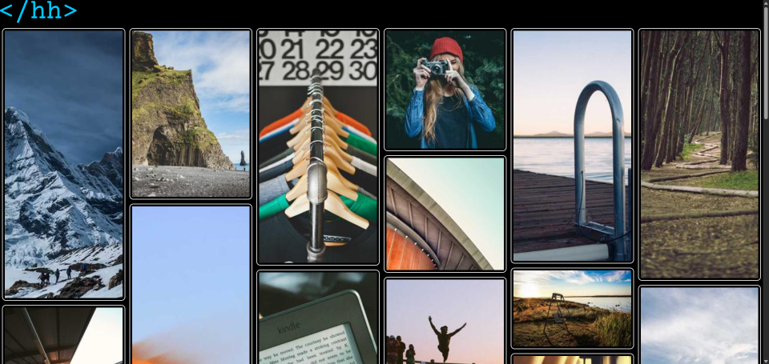

# Pinterest-like Grid

Dynamically updating index.html with JavaScript using random [Lorem Picsum](https://picsum.photos/) photos.

## Technologies

- HTML

- CSS

- JavaScript

## Features

- Responsive

- CSS column-count

- `createElement()`

- `appendChild()`

## Screenshots

Index

Index Mobile

