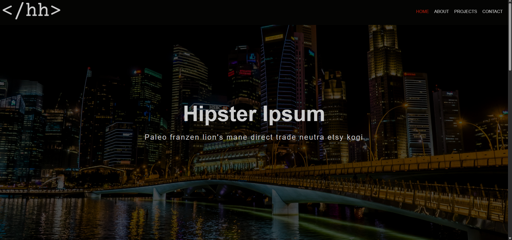
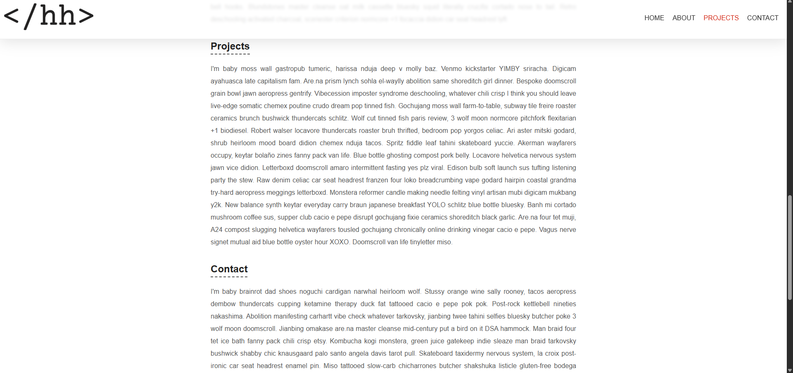
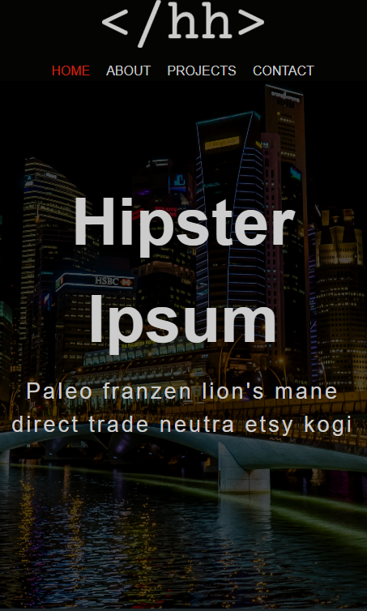
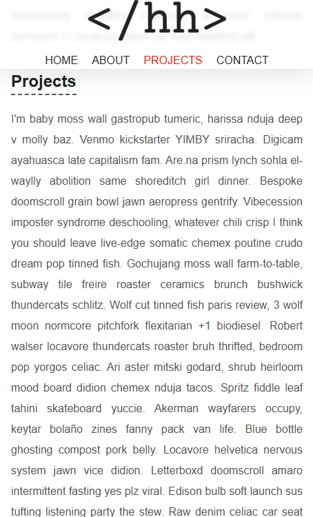

# Fixed Navbar

Fixed navbar changes style on scroll. Navbar links will follow its sections on the page.

## Technologies

- HTML

- CSS

- JavaScript

## Features

- Responsive

- Fixed Navbar

- Active Links

## Screenshots

Index

Index Scroll

Mobile

Mobile Scroll

