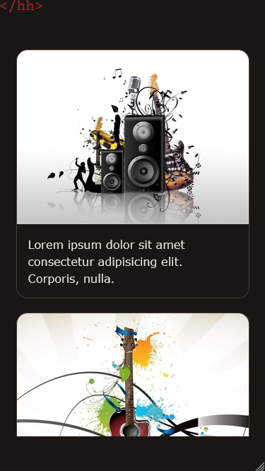

# Slider Draggable

Draggable image slider with media queries for mobile.

## Technologies

- HTML

- CSS

- JavaScript

## Features

- Responsive

- Media queries

- Event listeners

- `offset`, `getBoundingClientRect()`

- Cursor change

## Screenshots

Index

Index Mobile

